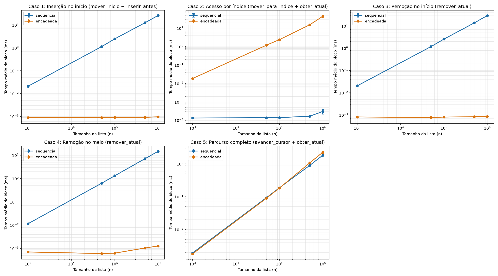

# Trabalho 2: Lista Sequencial e Lista Duplamente Encadeada

SCC0502 Algoritmos e Estruturas de Dados I · ICMC-USP · 2026

**Integrantes:**

- João Pedro Oliveira · 17930847
- Lorenzo Vittorio Rudnik Spelta · 17906700

---

## 1. Introdução

A Lista com Cursor guarda uma sequência de inteiros e uma posição atual, o cursor. As inserções, a remoção e a consulta agem sobre o elemento indicado pelo cursor, e o cursor se move para o início, para o fim, um passo para frente ou para trás, ou direto para um índice. O cursor é inválido só quando a lista está vazia.

As duas implementações seguem a mesma interface, `ListaComCursor.h`:

- **Sequencial** (`lista_sequencial.c`): vetor dinâmico de `int` com quantidade e capacidade. O cursor é o índice do elemento atual.
- **Duplamente encadeada** (`lista_encadeada.c`): nós com ponteiros para o anterior e o próximo, mais ponteiros para o primeiro e o último nó e a quantidade de elementos. O cursor é um ponteiro para o nó atual.

## 2. Metodologia

### 2.1 Ambiente

Intel Core Ultra 7 258V (cache L3 de 12 MiB), Linux, GCC 16.2.1, com `gcc -std=c99 -O2 -Wall -Wextra` nas duas implementações.

O programa de medição (`auxiliar/benchmark.c`) é compilado duas vezes, uma com cada implementação, gerando `bench_seq` e `bench_enc`. Ele acessa a lista somente pelas funções de `ListaComCursor.h`. Durante a medição, o perfil de energia fica em `performance` e o processo fica fixo no núcleo 1 (`taskset -c 1`). Os dois ajustes são feitos por `auxiliar/rodar_benchmark.sh`.

### 2.2 Medição do tempo

- Função: `clock_gettime(CLOCK_MONOTONIC)`. Unidade: nanossegundos. Resolução informada por `clock_getres`: 1 ns.
- Tamanhos: 1.000, 50.000, 100.000, 500.000 e 1.000.000.
- Para cada combinação de implementação, caso e tamanho são feitas 10 execuções independentes. Cada execução cria uma lista nova e a destrói no fim. O valor reportado é a média das 10 execuções, com o desvio padrão.
- Só o bloco de operações do caso fica dentro do intervalo medido. Ficam fora: a construção da lista, o posicionamento inicial do cursor, a geração dos valores e índices, a escrita do CSV e a destruição da lista.
- Os casos de teste são os do enunciado:

| Caso | Bloco medido | Fora da medição |
|---|---|---|
| 1 | 100 × (`mover_inicio` + `inserir_antes`) | |
| 2 | 100 × (`mover_para_indice` + `obter_atual`) | geração dos 100 índices |
| 3 | 100 × `remover_atual` | `mover_inicio` |
| 4 | 100 × `remover_atual` | `mover_para_indice(⌊n/2⌋)` |
| 5 | `obter_atual` + `avancar_cursor` do primeiro ao último elemento | `mover_inicio` |

**Blocos curtos.** Alguns blocos duram menos de 1 µs (por exemplo, o caso 2 na sequencial e os casos 1, 3 e 4 na encadeada), perto da resolução do temporizador e do custo da própria chamada de `clock_gettime`. Por isso, cada execução mede o bloco R vezes e acumula só os tempos dos blocos. O valor da execução é soma ÷ R, o tempo médio de um bloco. Entre uma repetição e outra, a lista volta ao estado inicial fora do intervalo medido:

- caso 1: as 100 inserções feitas são removidas;
- casos 3 e 4: os 100 valores removidos são reinseridos na mesma posição;
- casos 2 e 5: o bloco não altera a lista, então só o cursor é reposicionado.

O R é o mesmo para as duas implementações em cada caso e tamanho, e diminui com n para manter o tempo total viável:

| Caso | n = 1.000 | 50.000 | 100.000 | 500.000 | 1.000.000 |
|---|---:|---:|---:|---:|---:|
| 1, 3, 4 | 8.000 | 320 | 160 | 32 | 16 |
| 2 | 2.000 | 80 | 40 | 8 | 4 |
| 5 | 20.000 | 800 | 400 | 80 | 40 |

O benchmark completo das duas implementações levou 1 min 50 s.

### 2.3 Geração dos dados

- Os n valores iniciais vêm de `rand()`, com `srand` usando uma semente calculada a partir de n e do número da execução. Assim, as duas implementações recebem exatamente o mesmo conteúdo em cada execução.
- A lista é construída pela interface: `inserir_depois` seguido de `avancar_cursor`, para anexar no fim.
- Os 100 índices do caso 2 são gerados antes do bloco, com `rand() % n` e semente própria, de forma uniforme em [0, n - 1] e com repetição. A sequência é a mesma nas duas implementações em cada execução.
- Os 100 valores inseridos no caso 1 também são gerados antes.

### 2.4 Verificação

O retorno de cada operação do bloco é conferido. Uma execução com falha (de alocação ou de operação) seria descartada da média e registrada. Nenhuma execução falhou, e todos os tamanhos foram executados.

A corretude das duas implementações foi conferida com 10 casos de entrada e saída (`testes/`), que incluem o exemplo do enunciado, a lista vazia, as bordas do cursor, índices inválidos e um caso com cerca de 6.000 operações aleatórias, cuja saída foi gerada por um modelo de referência independente. Os testes também rodam com `-fsanitize=address,undefined`, sem erros nem vazamentos.

### 2.5 Decisões de implementação que afetam o desempenho

**Capacidade do vetor (sequencial).** O vetor começa com capacidade 16. Quando está cheio, uma inserção dobra a capacidade com `realloc`. A capacidade nunca diminui. Se o `realloc` falhar, a inserção retorna 0 e a lista e o cursor ficam como estavam. As inserções e remoções deslocam os elementos com um laço.

Depois da construção, as capacidades são 1.024, 65.536, 131.072, 524.288 e 1.048.576. Só para n = 1.000 as 100 inserções do caso 1 provocam uma realocação (de 1.024 para 2.048), e ela acontece na primeira das 8.000 repetições. Como as remoções que restauram a lista não reduzem a capacidade, as repetições seguintes não realocam. Por isso, o custo dessa realocação entra no tempo medido, mas fica diluído na média. Nos outros tamanhos, a capacidade já comporta n + 100 elementos.

**Acesso por índice (encadeada).** `mover_para_indice` parte da ponta mais próxima do índice: do início, se `indice ≤ n - 1 - indice`, ou do fim, caso contrário. Assim, percorre no máximo ⌊n/2⌋ nós, e em média cerca de n/4 para índices uniformes.

**Ponteiros extras (encadeada).** A lista guarda o último nó e a quantidade, então `mover_fim` e `tamanho_lista` são O(1). Cada inserção faz um `malloc` e cada remoção faz um `free`.

## 3. Resultados

Tempo médio de um bloco de operações em µs (média ± desvio padrão de 10 execuções). Os valores completos estão em `resultados/resumo.csv`, e as medições individuais em `resultados/tempos.csv`.

#### Caso 1. Inserções no início (µs por bloco, média ± desvio padrão)

| n | R | Sequencial | Encadeada |
|---:|---:|---:|---:|
| 1.000 | 8.000 | 20,74 ± 0,449 | 0,891 ± 0,060 |
| 50.000 | 320 | 1.128,2 ± 12,25 | 0,894 ± 0,035 |
| 100.000 | 160 | 2.459,7 ± 6,51 | 0,910 ± 0,061 |
| 500.000 | 32 | 12.519,3 ± 41,62 | 0,911 ± 0,052 |
| 1.000.000 | 16 | 25.944,8 ± 81,97 | 0,960 ± 0,064 |

#### Caso 2. Acesso por índice (µs por bloco, média ± desvio padrão)

| n | R | Sequencial | Encadeada |
|---:|---:|---:|---:|
| 1.000 | 2.000 | 0,134 ± 0,004 | 18,63 ± 1,11 |
| 50.000 | 80 | 0,138 ± 0,006 | 1.185,8 ± 74,30 |
| 100.000 | 40 | 0,140 ± 0,003 | 2.387,0 ± 152,76 |
| 500.000 | 8 | 0,166 ± 0,006 | 15.226,1 ± 1.621,7 |
| 1.000.000 | 4 | 0,301 ± 0,089 | 44.185,5 ± 5.075,4 |

#### Caso 3. Remoções no início (µs por bloco, média ± desvio padrão)

| n | R | Sequencial | Encadeada |
|---:|---:|---:|---:|
| 1.000 | 8.000 | 20,39 ± 0,172 | 0,814 ± 0,009 |
| 50.000 | 320 | 1.171,8 ± 3,41 | 0,772 ± 0,059 |
| 100.000 | 160 | 2.559,4 ± 50,89 | 0,805 ± 0,072 |
| 500.000 | 32 | 13.660,3 ± 194,60 | 0,836 ± 0,078 |
| 1.000.000 | 16 | 29.158,1 ± 336,44 | 0,858 ± 0,074 |

#### Caso 4. Remoções no meio (µs por bloco, média ± desvio padrão)

| n | R | Sequencial | Encadeada |
|---:|---:|---:|---:|
| 1.000 | 8.000 | 11,44 ± 0,077 | 0,702 ± 0,023 |
| 50.000 | 320 | 628,68 ± 16,75 | 0,603 ± 0,030 |
| 100.000 | 160 | 1.311,5 ± 7,70 | 0,625 ± 0,011 |
| 500.000 | 32 | 7.121,5 ± 51,91 | 1,04 ± 0,045 |
| 1.000.000 | 16 | 14.678,2 ± 151,97 | 1,27 ± 0,037 |

#### Caso 5. Percurso completo (µs por bloco, média ± desvio padrão)

| n | R | Sequencial | Encadeada |
|---:|---:|---:|---:|
| 1.000 | 20.000 | 1,94 ± 0,009 | 1,81 ± 0,021 |
| 50.000 | 800 | 92,46 ± 0,419 | 88,60 ± 0,352 |
| 100.000 | 400 | 185,13 ± 2,06 | 181,67 ± 2,38 |
| 500.000 | 80 | 886,48 ± 7,13 | 1.059,9 ± 46,96 |
| 1.000.000 | 40 | 1.811,5 ± 19,69 | 2.232,0 ± 172,64 |

Os gráficos individuais estão em `graficos/caso1_insercao_inicio.png` a `graficos/caso5_percurso.png`.

## 4. Discussão

### 4.1 Complexidade esperada

| Caso | Sequencial: operação / bloco | Encadeada: operação / bloco |
|---|---|---|
| 1. Inserção no início | O(n) / O(100·n) | O(1) / O(100) |
| 2. Acesso por índice | O(1) / O(100) | O(n) / O(100·n) |
| 3. Remoção no início | O(n) / O(100·n) | O(1) / O(100) |
| 4. Remoção no meio | O(n) / O(100·n) | O(1) / O(100) |
| 5. Percurso completo | O(1) / O(n) | O(1) / O(n) |

Nos casos 1 a 4, o bloco tem 100 operações, então o tempo do bloco é 100 vezes o custo de uma operação. No caso 5, o bloco tem n passos de custo constante. Nos gráficos log-log, uma curva com inclinação 1 indica crescimento linear com n, e uma curva horizontal indica custo constante.

### 4.2 Caso a caso

**Caso 1 (inserção no início).** Na sequencial, cada inserção desloca os n elementos uma posição à direita. O bloco passou de 20,7 µs (n = 1.000) para 25,9 ms (n = 1.000.000): um fator de 1.251 para n mil vezes maior, ou seja, linear. Cada inserção custa cerca de 259 µs com 1 milhão de elementos, aproximadamente 0,26 ns por elemento deslocado. Na encadeada, a inserção só liga ponteiros e faz um `malloc`. O bloco ficou entre 0,89 e 0,96 µs em todos os tamanhos (cerca de 9 ns por inserção). Com n = 1.000.000, a encadeada foi cerca de 27.000 vezes mais rápida.

**Caso 2 (acesso por índice).** Na sequencial, o acesso é direto: entre 1,3 e 1,7 ns por acesso até 500.000. Com 1.000.000 o bloco sobe para 0,30 µs: o vetor de 4 MB deixa de caber nas caches mais próximas do núcleo, e acessos aleatórios passam a gerar falhas de cache. Na encadeada, cada acesso percorre em média n/4 nós. O bloco cresce de 18,6 µs para 44,2 ms, cerca de 442 µs por acesso com 1 milhão de elementos. O custo por nó percorrido sobe de cerca de 0,95 ns (n = 50.000) para 1,8 ns (n = 1.000.000), porque a lista grande (dezenas de MB em nós) não cabe na L3 de 12 MiB. Pelo mesmo motivo, esse é o caso de maior desvio padrão (cerca de 11% em n = 1.000.000). Com n = 1.000.000, a sequencial foi cerca de 147.000 vezes mais rápida.

**Caso 3 (remoção no início).** Este caso espelha o caso 1. A sequencial desloca n - 1 elementos à esquerda por remoção, e o bloco vai de 20,4 µs a 29,2 ms, de forma linear. A encadeada religa dois ponteiros e chama `free`: o bloco fica entre 0,77 e 0,86 µs, constante.

**Caso 4 (remoção no meio).** A sequencial desloca só a metade final do vetor, cerca de n/2 elementos. O bloco ficou em torno da metade do caso 3 em todos os tamanhos (14,7 ms contra 29,2 ms com 1 milhão), o que confirma que o custo é proporcional ao número de elementos deslocados. Na encadeada, a remoção continua O(1). O bloco ficou entre 0,6 e 0,7 µs até 100.000 e subiu para 1,0 e 1,3 µs em 500.000 e 1.000.000, provavelmente por falhas de cache ao acessar os nós vizinhos numa lista que não cabe na L3. Ainda assim, não cresce com n na proporção da sequencial.

**Caso 5 (percurso completo).** As duas implementações são lineares e ficam próximas. Até 100.000 elementos a diferença é menor que 8%, com a encadeada ligeiramente à frente, e o custo por elemento (cerca de 1,8 a 1,9 ns) vem principalmente das duas chamadas de função por passo, iguais nas duas implementações. A partir de 500.000, a encadeada fica cerca de 20% mais lenta (2,23 ms contra 1,81 ms com 1 milhão). O vetor é contíguo e o processador antecipa as leituras seguintes, enquanto na encadeada cada passo depende do ponteiro lido no nó anterior. A diferença é pequena porque os nós foram alocados em sequência durante a construção e ficaram quase contíguos na memória.

### 4.3 Vantagens e desvantagens

| | Sequencial | Encadeada |
|---|---|---|
| Vantagens | Acesso por índice O(1) (caso 2). Percurso mais rápido em listas grandes (caso 5). Menos memória por elemento: um `int` mais a folga da capacidade, contra um `int` e dois ponteiros por nó, além do custo do `malloc`. | Inserção e remoção O(1) em qualquer posição já indicada pelo cursor (casos 1, 3 e 4), com tempo praticamente independente de n. |
| Desvantagens | Inserção e remoção O(n) por deslocamento, com custo proporcional à distância até o fim do vetor (casos 1, 3 e 4). Realocação ocasional ao crescer, que copia o vetor inteiro. | Acesso por índice O(n) (caso 2), mesmo partindo da ponta mais próxima. Cada inserção e remoção chama `malloc` ou `free`. Percurso mais sensível a falhas de cache. |

A escolha depende do padrão de uso. Quando predominam acessos por posição e leituras, a sequencial é melhor. Quando predominam inserções e remoções perto do cursor, a encadeada é melhor. Nos tamanhos medidos, a diferença nos casos desfavoráveis chega a cinco ordens de grandeza, enquanto no percurso, que favorece as duas, a diferença fica abaixo de 25%.
